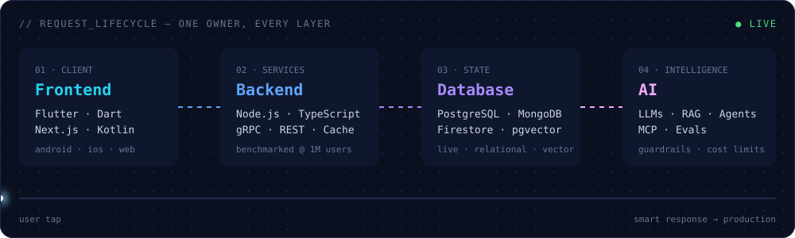

<p align="center">
  
</p>

<p align="center">
  <a href="https://YOUR-PORTFOLIO-URL"></a>
  <a href="https://YOUR-PORTFOLIO-URL"></a>
  <a href="https://www.linkedin.com/in/YOUR-LINKEDIN"></a>
  <a href="mailto:officialshantanugupta08@gmail.com"></a>
</p>

> [!NOTE]
> **`status: architecting AI systems @ Eureka Forbes`**: LLMs with retrieval, tools and agents, shipped inside the evals, guardrails and cost limits that production needs.

<br/>

## `⚡ system.profile`

```yaml
engineer:
  name: Shantanu Gupta
  location: Bangalore, IN
  current: Senior Manager, Tech @ Eureka Forbes
  runs_as: [Solution Architect, AI Solution Architect, Team Lead]

throughput:
  experience: 7+ years
  products_to_production: 10+
  users_served: 1M+
  enterprise_brands: 6+

operating_principles:
  - one owner across every layer, so nothing breaks at the hand-offs
  - models that ship, not demos
  - measure it before users see it
```

<br/>

## `🧬 architecture`

<p align="center">
  
</p>

<br/>

## `🧰 toolchain`

<table>
  <tr>
    <td width="130"><code>client</code></td>
    <td></td>
  </tr>
  <tr>
    <td><code>services</code></td>
    <td></td>
  </tr>
  <tr>
    <td><code>state</code></td>
    <td></td>
  </tr>
  <tr>
    <td><code>intelligence</code></td>
    <td>
      
      
      
      
      
      
      
      
      
      
    </td>
  </tr>
</table>

<br/>

## `🚀 deployments`

| | service | what it does | stack |
| :-: | :-- | :-- | :-- |
|  | **Aquaguard Apps** · Eureka Forbes | Customer, technician & IoT apps for Aquaguard purifiers | `Flutter` `Bloc` `IoT` |
|  | **NWORX** · Designs In Change | Learning & leadership platform with a micro-frontend design studio | `Flutter` `Firebase` |
|  | **Assessment Platform** | Secure 360° assessment, engagement, reporting & analytics | `Flutter` `Firebase` |
|  | **Yellowbacks** · Qart Fashion | Backend scaled and benchmarked for a million users | `Node.js` `Caching` |
|  | **Glyde Rides** | Vehicle-rental backend: live data + geo + transactions | `Node.js` `TS` `MongoDB` `PostgreSQL` |
|  | **Mr. Klean** | User app, admin portal & delivery app, end to end | `Flutter` `Node.js` |

<sub>→ full case studies, architecture decisions and an AI that answers from my profile: <b><a href="https://YOUR-PORTFOLIO-URL/projects">portfolio/projects</a></b></sub>

<br/>

## `📜 git log --career`

<details>
<summary><b>expand commit history</b></summary>
<br/>

```diff
+ HEAD → main   Senior Manager, Tech · Eureka Forbes
                solution architect · AI solution architect · team lead

+ a7f3e21       Lead App Engineer · Eureka Forbes            (Oct 2023)
                customer, technician & IoT apps; led hybrid mobile team

+ 5c19b0d       Senior Software Engineer · Designs In Change (Dec 2021 – Aug 2023)
                NWORX + Assessment on Flutter micro-frontends

+ 9e04d7a       Software Developer · Qart Fashion            (Sep 2019 – Nov 2021)
                QVenue, QStream; Yellowbacks backend → 1M users

+ 2b8c6f4       Software Developer · Glyde Rides             (Sep 2018 – Sep 2019)
                rental backend on GCP: MongoDB + PostgreSQL

+ 0d1e2a9       Intern · UrbanRider                          (Apr 2018 – Jul 2018)
                full app on Flutter + Firebase

! init          B.Tech, Information Technology · PSIT        (CGPA 8.3)
```

</details>

<br/>

<div align="center">

```console
$ ./connect --problem "your product"
→ routing to the right layer … frontend ✓ backend ✓ database ✓ ai ✓
→ one engineer assigned. response time: fast.
```

<a href="mailto:officialshantanugupta08@gmail.com"></a>

</div>
